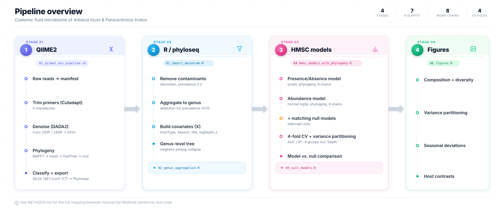

# Sea urchin coelomic fluid microbiome: QIIME2 + HMSC pipeline

Bioinformatic and statistical pipeline for the **coelomic fluid microbiome** of the sea urchins *Arbacia lixula* and *Paracentrotus lividus* (with surrounding seawater samples as environmental controls), from raw amplicon reads to joint species distribution models (HMSC) and manuscript figures.

## Pipeline overview

[](https://github.com/paubernado/urchin-microbiome-hmsc/blob/main/docs/pipeline_overview.svg)

The diagram above shows the pipeline as reported in the manuscript (QIIME2 → R/phyloseq → joint hurdle HMSC model + matching null model → figures). The repository also includes separate presence–absence and conditional abundance models (`R/Separate_models/`), reported in the Supplementary Material. See [Repository structure](#repository-structure) and [`METHODS.md`](https://github.com/paubernado/urchin-microbiome-hmsc/blob/main/METHODS.md) for details.

## Repository structure

```
.
├── README.md
├── METHODS.md                        # manuscript Methods ↔ code mapping
├── install_dependencies.R            # one-shot R package installer
├── environment.yml                   # QIIME2 conda environment
├── renv.lock                         # R package versions
├── docs/
│   └── pipeline_overview.svg
├── pipeline/
│   ├── 01_qiime2_asv_pipeline.sh     # raw reads → ASVs, taxonomy, tree, phyloseq export
│   └── 02_qiime2_reexport_archaea.sh # re-export retaining Archaea for phylogenetic rooting
├── R/
│   ├── Separate_models/              # presence–absence and conditional abundance models (Supplementary)
│   │   ├── 00_mcmc_config.R          # single source of truth for all MCMC settings
│   │   ├── 01_import_decontam.R      # import phyloseq, decontam, taxonomy cleanup, filtering
│   │   ├── 02_genus_aggregation.R    # aggregate to genus, build Y (counts) and X (covariates)
│   │   ├── 03_hmsc_models_no_phylogeny.R
│   │   ├── 04_hmsc_models_with_phylogeny.R
│   │   ├── 05_null_models.R          # intercept-only null models
│   │   ├── 06_figures.R              # master figure script
│   │   ├── 07_alpha_diversity_models.R
│   │   └── figures/
│   │       ├── fig2_composition_diversity.R
│   │       ├── fig3_alpha_diversity.R
│   │       ├── fig_variance_partitioning.R
│   │       ├── fig_seasonal_deviations.R
│   │       └── fig_host_contrasts.R
│   └── Joint_model/                  # joint hurdle model (main analysis)
│       ├── HMSC_STEP0_prepare_data.R # phylogenetic tree, Y matrix, covariates
│       ├── HMSC_STEP1_fit.R          # fit joint + null models (8 chains × 150,000 iter)
│       ├── HMSC_STEP2_cv_results.R   # CV, predictions, model fit metrics
│       └── run_cv_separate_models.sh # launcher script (nice 19, 8 cores)
├── results/                          # .rds objects (not tracked in git)
├── figures/                          # .pdf / .png output
└── data/
    └── README.md                     # how to obtain metadata, raw reads, etc.
```

Large intermediate files (`results/*.rds`, raw reads, reference databases) are not tracked in this repository. See `data/README.md` for how to regenerate or download them.

## Setup

### QIIME2 (bash pipeline)

```bash
conda env create -f environment.yml
conda activate qiime2-2022.11
```

### R (statistical pipeline)

**Quick start** (installs latest versions, no version pinning):

```r
source("install_dependencies.R")
```

**Exact reproduction of the paper's package versions** (recommended):

```r
install.packages("renv")
renv::restore()   # installs the exact versions listed in renv.lock
```

Key R packages: `phyloseq`, `decontam`, `microbiome`, `Hmsc`, `coda`, `picante`, `ape`, `ggplot2`, `patchwork`, `ggh4x`, `qiime2R`, `lme4`, `lmerTest`, `glmmTMB`, `car`, `emmeans`, `multcomp`, `multcompView`.

## Running the pipeline

1. **QIIME2** — raw reads → ASVs, taxonomy, tree:

```bash
bash pipeline/01_qiime2_asv_pipeline.sh
bash pipeline/02_qiime2_reexport_archaea.sh   # re-export retaining Archaea for rooting
```

2. **Joint hurdle model** (main analysis):

```bash
# Prepare data (phylogenetic tree, Y matrix, covariates)
Rscript R/Joint_model/HMSC_STEP0_prepare_data.R

# Fit joint model + null model (8 chains × 150,000 iterations; runs on cluster)
Rscript R/Joint_model/HMSC_STEP1_fit.R --model joint

# Cross-validation and model fit metrics
bash R/Joint_model/run_cv_separate_models.sh
```

3. **Separate models** (Supplementary; see `R/Separate_models/`):

```r
source("R/Separate_models/01_import_decontam.R")
source("R/Separate_models/02_genus_aggregation.R")
source("R/Separate_models/04_hmsc_models_with_phylogeny.R")
source("R/Separate_models/05_null_models.R")
```

4. **Alpha diversity models**:

```r
source("R/Separate_models/07_alpha_diversity_models.R")
```

5. **Figures**:

```r
source("R/Separate_models/06_figures.R")
```

## MCMC settings

| Model | chains | iterations/chain | transient | thin | posterior samples |
|-------|--------|-----------------|-----------|------|-------------------|
| Joint hurdle (main) | 8 | 150,000 | 50,000 | 400 | 2,000 |
| Presence–absence (Supplementary) | 8 | 206,000 | 6,000 | 20 | 80,000 |
| Conditional abundance (Supplementary) | 8 | 206,000 | 6,000 | 20 | 80,000 |

## Alpha diversity model specification

| Metric | Model | Response scale |
|--------|-------|----------------|
| Shannon diversity | Linear mixed model (`lme4`/`lmerTest`) | Raw |
| Faith's PD | Linear mixed model (`lme4`/`lmerTest`) | log |
| Pielou's evenness | Beta-regression mixed model (`glmmTMB`, logit link) | Raw (0–1) |

All three: `metric ~ HostType * Season + (1 | Site)`, rarefied to 5,000 reads/sample (seed = 123). Fixed-effect significance via Type II Wald chi-square tests (`car::Anova`); pairwise contrasts via `emmeans`, Benjamini–Hochberg corrected.

## Status

This repository accompanies a manuscript currently in preparation. A citation (and DOI, once available) will be added here.

## License

This project is licensed under the MIT License — see LICENSE for details.
